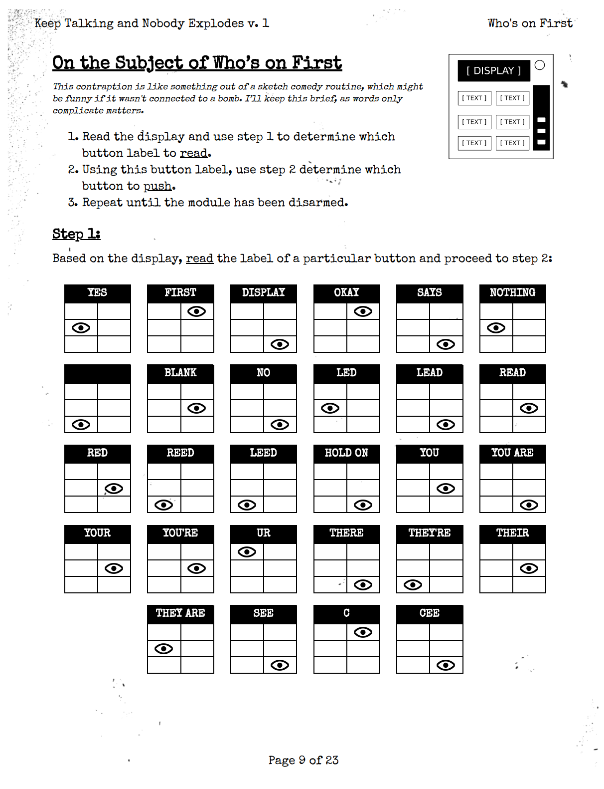
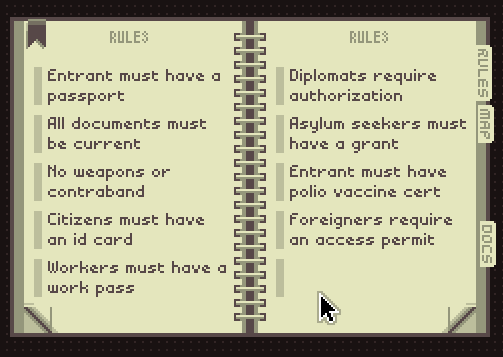
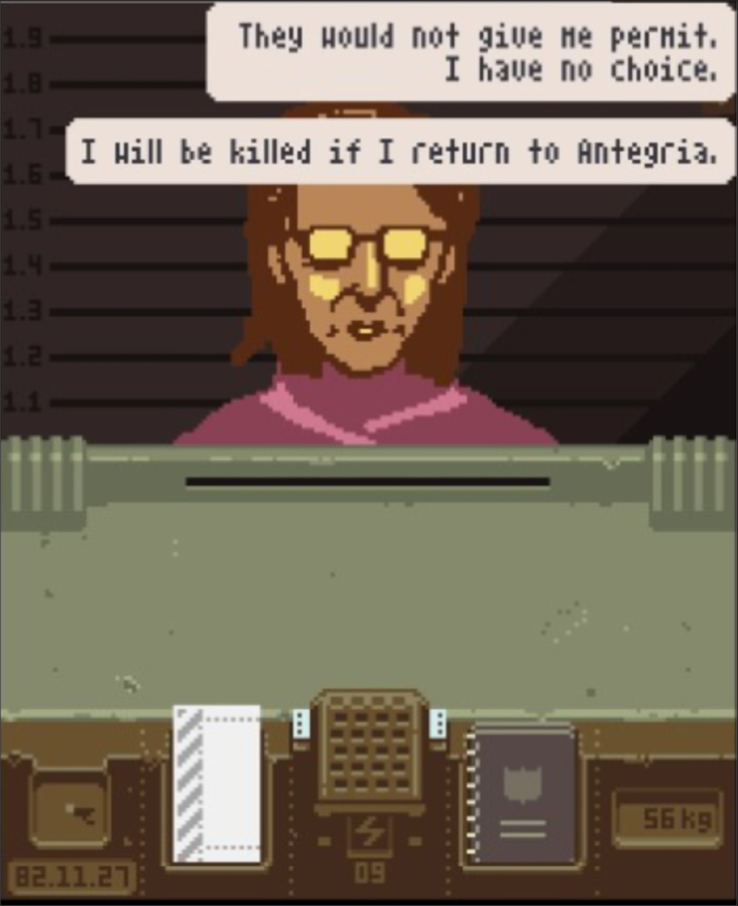

# In what ways can structural design choices in written in-game instructions minimise cognitive load and tutorial friction in puzzle interfaces?

## Introduction (481)
Instructional design is easily one of the trickiest and most overlooked parts of making a video game. While written instructions are necessary to explain rules, controls and core mechanics, they often end up causing a massive amount of frustration for players during the onboarding process. Research shows that long, messy or overly complicated text layouts make games harder to understand and quickly tire players out mentally. When tutorials rely on clunky layouts or drop massive blocks of text on screen all at once, the design fails to teach mechanics properly. Instead of helping players get straight into the game, this poor layout structure builds an artificial wall that makes the experience feel annoying before it even properly starts.  
This essay looks into one main question: In what ways can structural design choices in written in-game instructions minimise cognitive load and tutorial friction in puzzle interfaces? By treating written instructions as visual UI assets rather than observing live players in a test environment, this essay looks at how specific design choices - like text length, layout structure, visual hierarchy and formatting - change how clear an interface feels to navigate.  
To explore this topic thoroughly, the essay breaks down into three key theoretical areas. First, it looks at existing research on visual processing and text formatting, using published eye tracking data to see how players scan and read text on screen and where their visual focus actually lands when reading in-game documentation. Second, it applies Cognitive Load Theory to look at how dense text and constant context switching slow players down, particularly in puzzle environments where they have to figure out complex rules on their own without external help. Finally, it explores practical ways to design cleaner instructional layouts, showing how simpler information structures make interfaces much easier to process and keep players engaged. Overall, this research provides a theoretical look at how UI design can make instructions easier to read without needing to run primary player tests.  
Beyond looking at basic readability, this essay also addresses the specific user experience challenges found in single player puzzle games where instructions act as an active gameplay element. When players must constantly reference a manual, notebook or guide while attempting to solve timed or complex puzzles, the layout of that text becomes just as important as the puzzle mechanics themselves. Poorly spaced text, bad font choices or confusing section headers force players to waste mental energy just trying to locate the right rule, leading to unnecessary fatigue and avoidable mistakes. By breaking down how layout decisions impact working memory, this essay shows how smart visual organisation can keep a game challenging for the right reasons rather than being difficult simply because the text is hard to understand and read. Ultimately, understanding these structural user interface principles gives designers a clear framework for building instructional manuals that inform players clearly without overwhelming them.  

## Literature Review (including theoretical and conceptual framework) (Word goal: 1500) (Word Count: 1426)

### 1 (532)
To start answering this question, I started by researching a study done by Rifat Ara Tasnim, Md Mosharaf Hossan and Farjana Z. Eishita (Tasnim et al., 2024) on the impact of how written instructions within video games are presented and designed. This study took 30 participants and had them three groups of ten play a different version of the same game, the only difference being the design and layout of the different instructions. The first version had a very simple layout, using a light gray font on a blue background with a light gray button. The second version uses a dark grey font on a bright white background, with a bright red start button and images of fruits and plants surrounding the instructions. The third and final layout was just like the first version, but missing the start button. This version had the text turn red one word at a time as if reading along with you. It would take twelve seconds for all the text to turn red, at which point the start button would appear, allowing the player to start. The results of this test concluded that the third version resulted in "the players exerted more effort while playing" and "the players experienced the highest level of ease of control and progress feedback for the gameplay." This test also found that the results of the bright and colourful version two "remained consistently low. This outcome aligns with the majority number of players not correctly following the instructions for this particular version of gameplay."  
What intrigued me the most whilst also making the most sense about these results is the fact that the best looking instructions caused the players to perform the worst compared to the other participants. As a game developer who has also taken a design course, you always want what you make to draw people in and look high quality, instead of just being plain boring text on a screen, but it seems that the plain boring text is the way to go when creating instructions. I found the idea of locking the start/continue button behind a timed lock very smart. Hiding the button from the player for them to continue seems like something that would annoy the player, which it probably would annoy a few, but it also is a very clever idea design wise as it not only gives the player time to read the instructions but also kind of forces them to read them carefully and within a space of time that the developer feels necessary for the player to take in the instructions. Although this is a very good idea on paper, I feel this wouldn't work for most instructions in video games, especially not in the game I want to make. In terms of most games, written instructions are something players can pick up or see and they can choose to read it or figure it out on their own, if this was forced and made it so they had to wait however, I feel that the player would feel to restricted with how they player the game. And when it comes to my game idea, the instructions are supposed to be read whilst doing other things so there can not be any sort of locking the player out of moving on until they are done reading. 
This test helps answer the question by showing that instructions shouldn't be too complex in design, a simple design works best.

### 2 (437)
After researching layout, I looked into how instructions are read by players and where they look when reading them. To figure this out, I examined an eye tracking study done by Haiting Lan, Sixin Liao, Jan-Louis Kruger and Michael J. Richardson (Lan et al., 2025) on how players process written language within video games. While their specific test looked at subtitled instructions rather than static manuals, their finding on visual attention and reading behavior offer a brilliant parallel to how players navigate text heavy in game documentation. The study revealed that players actively filter information, focusing their visual attention strictly on text relevant to their immediate goals. More importantly, the study found that when players rely entirely on visual text without any audio guidance, they show lower word skipping rates and have to exert much higher cognitive effort on words loaded with "immediate action-related information".  
The results from this study both helps the development of my game, as the instructions within my game won't have any audio guidance so players won't be skipping words, whilst also helping with the question. This test shows that audio guidance pairs perfectly with written instructions if you want to minimise the cognitive load of the player. This is likely because audio guidance assists the player in finding out information alongside them reading the text, whereas without the audio guidance, the player is left to find all the information alone. This paired with a timed or high intensity situation in game would create a stressful situation for the player. For some games however, including the one I am making, developers want to create that stress and higher the player's cognitive load, but not by too much, so looking into having some audio guidance could be the perfect addition to control the balance between a high load and the gameplay/reading being too relaxed.  
Building on this, the way a written document organises its conditional logic directly dictates how efficiently a player can translate text into physical gameplay actions. When playing games featuring extensive text instructions, players cannot afford to read blocks of text sequentially from top to bottom. Instead, they rely heavily on typographic hierarchies, bullet points and spatial grouping to triage information. If these formatting layers are neglected, the cognitive load spikes drastically. The eye tracking patterns identified by Lan et al. demonstrate that human processing limits require deliberate visual signposting. Therefore, for a written tutorial to successfully onboard a player without inducing frustration and tutorial friction, its visual layout must actively work in tandem with the reader's natural scanning habits, minimising the decoding effort so that the player can focus entirely on solving the challenge at hand.

### 3 (457)
The final paper I read was by Erik Andersen, Eleanor O'Rourke, Yun-En Liu, Rich Snider, Jeff Lowdermilk, David Truong, Seth Cooper and Zoran Popovic (The impact of tutorials on games of varying complexity, s.d.) and this one covered all things tutorials. They experimented with tutorials they created across three different games of varying complexity to test how they affected the players gameplay. 45,000 players were tested and from this test they discovered that "tutorial effectiveness depends on the complexity of the game" and that tutorials were only effective on the most complex game were the player would have struggled to get an understanding of what is required of them through experimentation. The results of this test show that experimentation over tutorials is something that needs to be greatly considered in a lot of games, not only because tutorials have less of an effect in less complex games, but also because players learn better through experimentation and a lack of tutorial reduces early onset burnout and the chance of tutorial friction.  
Adding help on demand options was another feature experimented with during this test. Players were given a tutorial and a help on demand button in some games and instead of helping the players as you would expect it to, they discovered that it was only effective in one of their games, in the other one it "reduced player progress by 12% and play time by 15% in Refrac-tion." This further proves the point that different methods of teaching the player are required for each game as one method does not work for every situation.  
Building on this, these findings offer a critical perspective on how written documentation impacts cognitive load and tutorial friction within puzzle interfaces. In games that rely heavily on written manuals or static guides, such as Keep Talking and Nobody Explodes (Keep Talking and Nobody Explodes - Defuse a bomb with your friends., s.d.), the text itself forms the core puzzle environment. When instructions are presented as dense, out of context manuals rather than clear, easily accessible references, they introduce unnecessary friction by forcing the player to read complex riles under tight time constraints. The negative impact observed with the on demand help button in Refraction highlights how poorly integrated text resources can actively frustrate players and disrupt their focus.  
This directly connects to my research question by showing that the layout and presentation of written instructions are just as important as the mechanics themselves. If a written tutorial drops massive blocks of text on screen or buries key rules inside confusing layouts, it places massive burden on the player's working memory. Instead of spending mental energy solving the actual puzzle, the player wastes time and focus just trying to navigate the documentation. For a written instruction manual to successfully minimise cognitive load and avoid tutorial friction, its visual hierarchy, layout and structure must allow players to locate and process key action triggers instantly, ensuring that the interface aids their problem solving rather than becoming and artificial roadblock.

## Case Studies (analysis of examples of existing practice) (Word Goal: 1000) (Word Count: 1099)

### Keep Talking And Nobody Explodes 602
The best game to look into and discuss for this question has to be Keep Talking and Nobody Explodes(Keep Talking and Nobody Explodes - Defuse a bomb with your friends., s.d.), a game that focuses on complex instructions as a means to add challenge to the gameplay. This is done by purposely increasing the cognitive load of the player by using a tough to read instruction layout alongside difficult puzzle layouts. Instead of laying everything out clearly like normal manuals, the game hides rules behind dense walls of text, complicated flowcharts and look-alike symbols that force the player to stop and figure out what it is they are actually looking at.  
Looking deeper into the instructions, it is very clear what methods the game designers used to complicate the instructions for the player, resulting in an increase to there cognitive load. One way this is done is by using unsorted lists. On the Who's on First puzzle, the first step requires the reading player to request the word given by the bomb so that they can find which button needs pressing, the list they have to find that word in however is completely out of any sort of order, increasing the solve time and complexity as the player needs to read through till the word is found. Then the second step requires the reading player to request another word from player one, which they need to find from another list, and then from that word, they need to search through it's unique, unordered list to find the correct word to give back to player 1.   

*Figure 1. The first page of the Who's on First puzzle manual*
 

*Figure 2. The second page of the Who's on First puzzle manual*
 
 
A second way that the manual is made to confuse the player is by using fictional symbols within puzzles, causing the players to have to describe them to each other, hoping the other player would be able to picture the same symbol in their head and select the correct one. This is seen in a few puzzles but the one I looked at was the On the Subject of Keypads puzzle. This puzzle requires player one to have to describe four symbols that they can see on their bomb and then the reading player has to find all four of those symbols within six columns, find which one they all fit into and then read the symbols back that they appear in said column. This is not only a difficult puzzle due to having the describe made up symbols, but also because once again, there is no order to the symbols or columns, making the flow of the puzzle non-existent.    

*Figure 3. The Keypads puzzle manual*
 
 
After looking at the manual, I read through player feedback and reviews, specifically a review on Rock Paper Shotgun (Hivemind and RPS, 2015). Within the review, they discuss their feelings on the game itself but also the layout and design of the manual. Within the review, Graham says "But when there's a counter ticking down, even one I can't see, I panic and dismiss the header and small italics as unimportant, and then try to skim-read the bullet points. I wonder if typography and the cues that sends about which pieces of information are important is a deliberate part of the game design." This observation highlights how the manual deliberately subverts conventional UX principles by using typographic hierarchy to induce cognitive overload, effectively turning the act of reading into a high-stakes game mechanic.  
Within this review Pip says "There's one module in the manual called 'Complicated Wires' and looking at that one I can feel my brain panicking. It's like normal wires except now some of them are STRIPEY and there are LEDs involved and the solution is this weird Venn diagram that looks more like some horribly complicated planetary orbit." This quote focusses more on the cognitive load side as it covers the fact each puzzle, mainly the wires puzzle, consists of many changing and additional variables, such as the wire colour and type, that completely change and complicate how the player processed and communicates the visual data, forcing a sudden cognitive gear shift, which explains Pip's immediate sense of panic. 
Taken together, these design choices illustrate how intentionally inflating cognitive load forces players to negotiate meaning under pressure, demonstrating that friction within a game's instructions can be just as vital to cooperative engagement as the mechanics themselves.  

### Papers Please 497
Whilst Keep Talking and Nobody Explodes distributes its instructional complexity across multiple players, Papers, Please (Papers, Please, s.d.) forces a single player to bear the entire weight of cross-referencing dense rules and visual discrepancies alone. The main difference between the two games is the Papers, Please is a lot easier to pick up as a new player as it starts with no rules except do not let anyone in without valid paperwork. Rather than front-loading complexity like a static manual, Papers, Please slowly builds cognitive load by introducing new rule book pages and extra documents over time, forcing the player to manage and increasingly cramped desk under strict time constraints.  
The result of having an increase in new rules is that more documents have to be provided and more methods have to be used by the player. The player goes from just needing a valid passport to needing a work permit, to not letting certain countries enter, to having to perform x-rays, to needing to take finger prints and even snipe terrorists who have climbed the border wall. The game definitely starts easy but by the end of it, you feel like you are juggling a million tasks just to deny or accept one person into the country.  
Beyond the sheer volume of rules, the physical layout and visual design of the in-game rule book actively contribute to this cognitive overload by forcing the player to constantly flip between tabbed sections and cross reference dense pages within a cramped workspace. Written in terse, cold bureaucratic legalese - such as "Arstotzkan citizens only" or "Entrants must have a work pass" - the text strips away any helpful context or examples, forcing the player to interpret rigid, absolute statements while an entrant waits impatiently at the booth.    

*Figure 4. The rulebook in Papers, Please*
 
 
A review of the game by Leigh Alexander on the website gamedeveloper.com (Designing the bleak genius of Papers, Please, s.d.) discusses the the creator of the game, Lucas Pope, adopted a bureaucratic text structure, naturally allowing him to layer complex, gameplay oriented rules and regulations on the player. The creator says that "On some level I want players to reach a point of self-realization—about how good people can be turned into uncaring cogs.". This covers one of the main topics of the game, empathy. There are moments in the game where people won't have the correct documents to enter the country but will have a situation and emotional reason that they need to enter the country for, leaving the player to make a moral choice on wether they want to help them or care more for their job and themselves. Overloading the player's cognitive load with dense text rules, overlapping documents and strict timers induces a state of cognitive tunnel vision, reducing them to the exact "uncaring cog" Pope describes by making blind adherence to the rule book far easier than risking penalties for an act of empathy.    

*Figure 5. A character asking to be let in despite not having the correct documents as they would be killed back in their own country.*
 
 
Looking at Papers, Please through the lens of my research question highlights a clear design lesson for my own project: progressive disclosure can prevent early tutorial friction but written instructions must remain scannable and spatially organised if the goal is to minimise extraneous cognitive load rather than induce stress.  

## Conclusion and Reflection on Practice 500

## Bibliography
### Literature Review
- Tasnim, R. A., Hossan, M. M. and Eishita, F. Z. (2024) 'Analyzing Differential Impact of Text-Based Instructions in Video Games' In: 2024 Intermountain Engineering, Technology and Computing (IETC). 2024 Intermountain Engineering, Technology and Computing (IETC). pp.227–232. At: https://ieeexplore.ieee.org/abstract/document/10564249 (Accessed  03/11/2026).
- Lan, H., Liao, S., Kruger, J.-L. and Richardson, M. J. (2025) 'Processing Written Language in Video Games: An Eye-Tracking Study on Subtitled Instructions' In: Journal of Eye Movement Research 18 (5) p.44.
- The impact of tutorials on games of varying complexity (s.d.) At: https://dl.acm.org/doi/epdf/10.1145/2207676.2207687 (Accessed  03/11/2026).
- Keep Talking and Nobody Explodes - Defuse a bomb with your friends. (s.d.) At: https://keeptalkinggame.com/ (Accessed  04/11/2026).

### Case Studies
- Keep Talking and Nobody Explodes - Defuse a bomb with your friends. (s.d.) At: https://keeptalkinggame.com/ (Accessed  04/11/2026).
- Hivemind, R. P. S. and RPS (2015) 'The RPS Verdict: Keep Talking And Nobody Explodes' In: Rock, Paper, Shotgun 29/10/2015 At: https://www.rockpapershotgun.com/keep-talking-and-nobody-explodes-review (Accessed  22/11/2026).
- Papers, Please (s.d.) At: https://papersplea.se/ (Accessed  22/11/2026).
- Designing the bleak genius of Papers, Please (s.d.) At: https://www.gamedeveloper.com/design/designing-the-bleak-genius-of-i-papers-please-i- (Accessed  22/11/2026).

